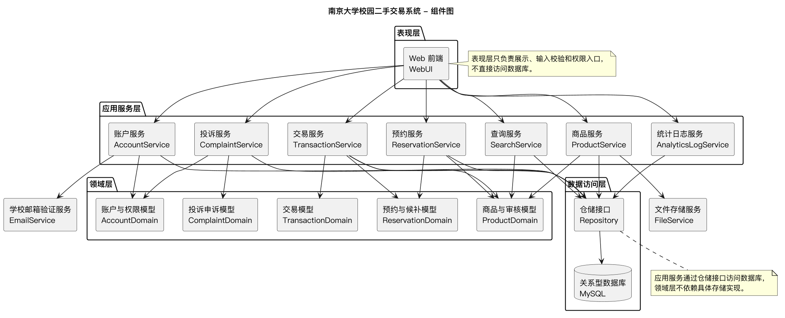
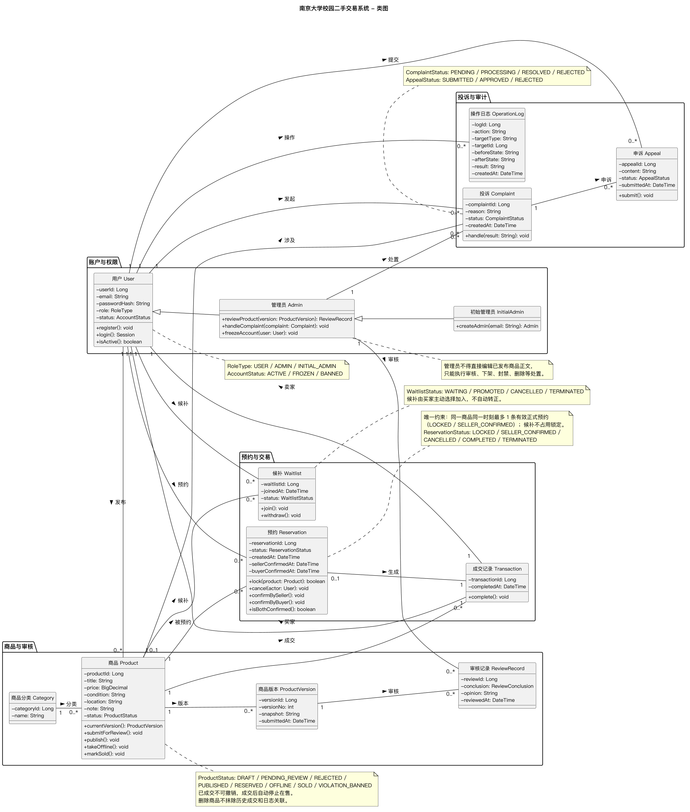
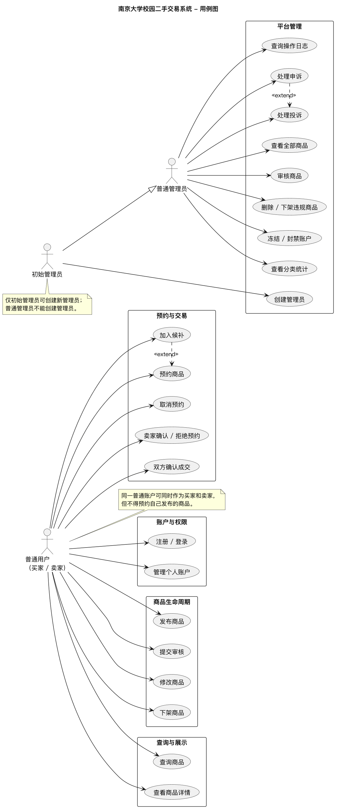
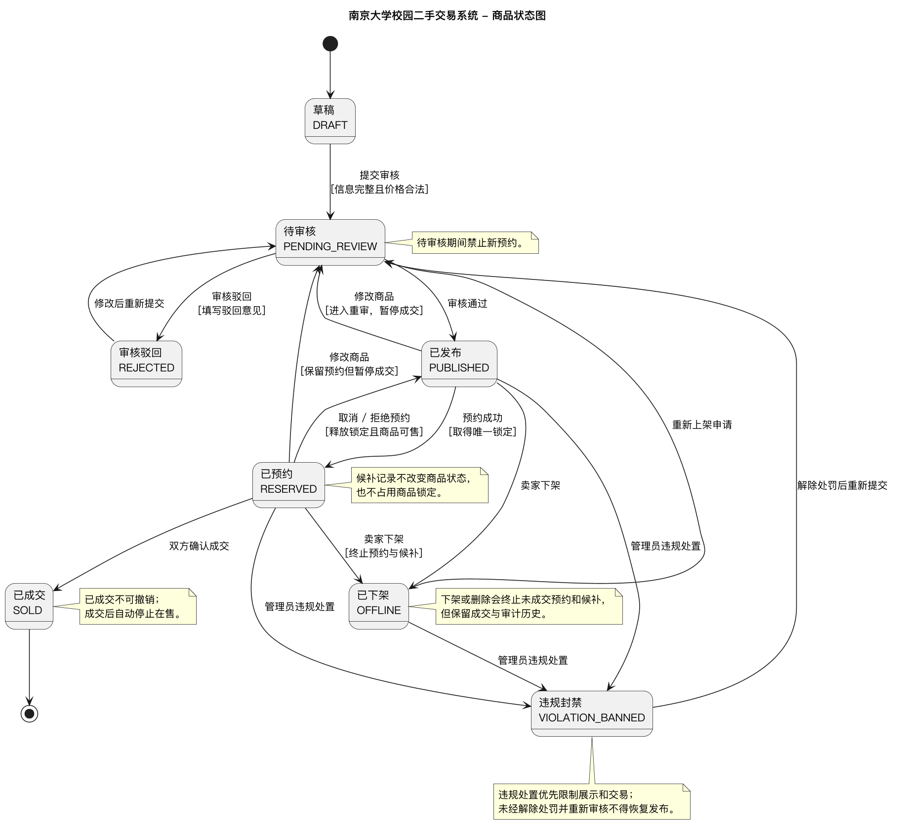
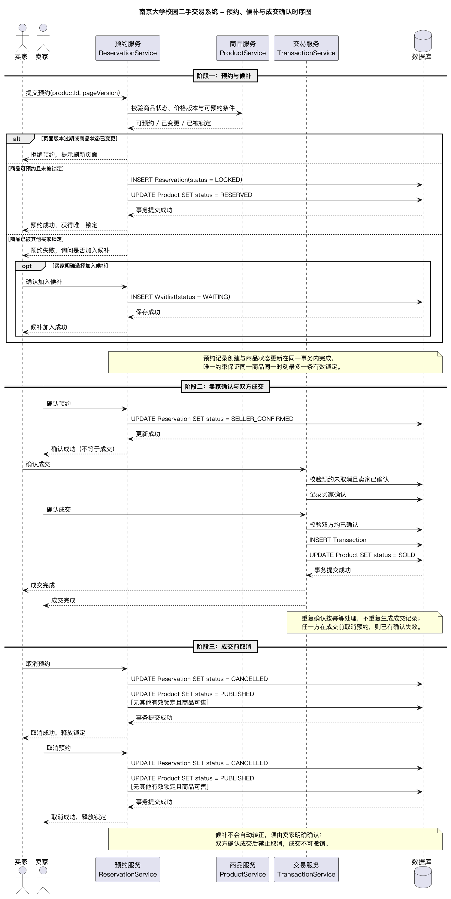

\newpage

# 一、项目概述与主要功能

本项目是南京大学校园二手交易系统，面向校内学生提供闲置商品的信息展示、购买意向预约和线下交易结果记录。系统采用线上预约、线下交易的方式，不把在线支付和物流履约作为交易闭环的必要步骤，也不实现原生手机 App。

系统在业务上区分普通用户、普通管理员和初始管理员。普通用户同一账户可以同时作为买家和卖家；管理员负责商品审核、违规处置、投诉申诉、统计和日志查询；初始管理员额外拥有创建新管理员的权限。

主要功能如下：

| 功能模块 | 主要功能 |
|---|---|
| 账户与权限 | 学校邮箱注册与登录、角色权限、管理员创建、冻结和封禁账户 |
| 商品与审核 | 商品草稿、提交审核、审核通过或驳回、修改重审、下架、重新上架、违规处置 |
| 查询与展示 | 按关键词、分类、价格区间和状态查询商品，按价格或发布时间排序，查看商品详情 |
| 预约与候补 | 预约成功即锁定、并发先到先得、重复预约拒绝、旧页面请求拒绝、候补、取消预约、卖家确认或拒绝 |
| 交易确认 | 买卖双方分别确认成交，双方均确认后完成交易，成交不可撤销 |
| 投诉与申诉 | 商品投诉、违规处置、账号或商品申诉 |
| 统计与日志 | 分类商品数量与成交数量统计，关键操作日志记录和查询 |

系统的核心业务难点不在单个页面的增删改查，而在商品状态、预约状态和成交结果之间的一致性：同一商品最多只能有一个有效正式预约，候补不占用锁定，改价重审期间旧预约暂停成交，双方确认后成交不可逆。

# 二、软件模块划分与整体架构

软件采用分层架构，自外向内分为表现层、应用服务层、领域层和数据访问层。表现层只负责界面展示、输入校验和权限入口；应用服务层组织业务用例和事务边界；领域层保存商品、预约、交易等核心业务规则；数据访问层通过仓储接口访问关系型数据库。学校邮箱验证和文件存储作为外部服务接入。

{width=95%}

模块划分如下：

| 模块 | 职责 | 主要对应需求 |
|---|---|---|
| 账户与权限模块 | 注册登录、角色识别、管理员创建、冻结封禁、账户状态校验 | REQ-002~REQ-010 |
| 商品与审核模块 | 草稿、送审、审核、修改重审、上下架、违规处置和商品状态维护 | REQ-011~REQ-027 |
| 查询与展示模块 | 关键词、分类、价格、状态筛选，排序和详情展示，按权限过滤可见性 | REQ-030~REQ-036 |
| 预约与候补模块 | 唯一锁定、并发控制、重复预约拒绝、旧页面校验、候补、取消和卖家确认 | REQ-037~REQ-045 |
| 交易确认模块 | 买卖双方确认成交、成交记录生成、成交不可逆和商品停止在售 | REQ-046~REQ-047 |
| 投诉与申诉模块 | 商品投诉、违规处置、申诉和恢复发布条件 | REQ-022~REQ-024 |
| 统计与日志模块 | 分类商品统计、成交统计、关键操作日志记录和查询 | REQ-036、REQ-048~REQ-050 |
| 基础设施与安全 | 认证、数据库、并发控制、敏感信息保护和数据隔离 | REQ-051~REQ-056 |

这样划分的原因是：商品生命周期和预约交易是两条相互影响但职责不同的主线。商品模块负责“商品能否被看见、能否被预约”，预约交易模块负责“谁取得锁定、预约如何取消、何时成交”。把两者拆开，可以让状态变更通过明确的业务接口发生，避免页面直接修改商品状态。审核、投诉、统计和日志属于平台管理职责，单独成模块，可以减少普通用户业务与管理业务之间的耦合。

在依赖关系上，表现层只调用应用服务；应用服务依赖领域模型和仓储接口；领域层不依赖具体数据库实现。这样可以把并发锁定、状态转换和唯一性约束放在服务层和领域层统一处理，而不是散落在各个界面中。

# 三、领域模型类图

领域模型围绕用户、商品、审核、预约、候补、成交、投诉和日志展开。

{width=95%}

核心类和关系如下：

- `User` 表示普通用户，`Admin` 和 `InitialAdmin` 表示管理员身份。一个用户可以发布多件商品、产生多条预约和候补记录。
- `Product` 表示商品，保存名称、价格、成色、交易地点、备注和当前状态，并通过 `currentVersion()` 获取当前审核版本；`Category` 表示商品分类。
- `ProductVersion` 保存商品修改后的审核版本，`ReviewRecord` 保存审核人、审核结论和意见。这样改价重审和旧页面冲突可以追溯到具体版本。
- `Reservation` 表示正式预约，保存买家、商品、状态、卖家确认时间和买家确认时间；`Waitlist` 表示候补，候补不占用商品锁定。
- `Transaction` 表示双方确认后生成的成交记录，成交记录一旦生成不可撤销。
- `Complaint` 和 `Appeal` 分别表示投诉和申诉；`OperationLog` 保存关键操作的动作、对象、前后状态和结果。

类图中的关键约束如下：

1. 同一商品同一时刻最多只有一条有效正式预约，对应状态为 `LOCKED` 或 `SELLER_CONFIRMED`。
2. 候补记录不占用商品锁定，也不会自动转正，必须由卖家明确确认。
3. 商品可以有多个历史版本和多次审核记录，任一时刻只有一个当前版本。
4. 双方确认成交后生成成交记录，商品停止在售，成交不可撤销。
5. 商品删除或下架不能抹除历史成交和日志关联。

这些约束是类图设计的重点。仅画出类名和关联不足以支持后续实现，必须在模型中明确唯一性和状态语义。

# 四、角色权限与用例图

系统有三类角色：普通用户、普通管理员和初始管理员。普通用户同时具备买家和卖家操作能力，但不得预约自己发布的商品，也不得管理他人商品。普通管理员可以审核商品、处置违规商品、冻结封禁账户、处理投诉申诉、查看统计和日志，但不能创建其他管理员。初始管理员继承普通管理员权限，并独有创建管理员的权限。

{width=52%}

用例图按账户与权限、商品生命周期、查询与展示、预约与交易、平台管理五组组织。普通用户覆盖注册登录、商品发布与修改、查询、预约、候补、取消、卖家确认和双方成交；管理员覆盖查看全部商品、审核、违规处置、账户处置、投诉申诉、统计和日志；初始管理员在此基础上增加创建管理员。

候补用 `<<extend>>` 表示它对预约用例的扩展：买家只有在正式预约未取得锁定时，才会被询问是否加入候补。申诉同理，是对投诉处理结果的扩展。这样可以把正常主流程和异常补充流程区分开。

# 五、商品状态机

商品共有八种业务状态：草稿、待审核、审核驳回、已发布、已预约、已下架、已成交和违规封禁。

{width=88%}

主要状态转换如下：

| 起始状态 | 触发操作 | 结果状态 | 约束 |
|---|---|---|---|
| 草稿 | 提交审核 | 待审核 | 信息完整、价格合法 |
| 待审核 | 审核通过 | 已发布 | 审核通过后才能公开 |
| 待审核 | 审核驳回 | 审核驳回 | 填写驳回意见 |
| 审核驳回 | 修改后重新提交 | 待审核 | 不能跳过审核直接发布 |
| 已发布 | 预约成功 | 已预约 | 取得唯一锁定 |
| 已预约 | 取消或拒绝预约 | 已发布 | 释放锁定且商品可售 |
| 已发布/已预约 | 卖家下架 | 已下架 | 已预约商品下架时终止预约和候补 |
| 已下架 | 重新上架申请 | 待审核 | 不能直接恢复为已发布 |
| 已发布/已预约 | 修改商品 | 待审核 | 进入重审，暂停成交，旧预约按规则保留 |
| 已预约 | 双方确认成交 | 已成交 | 双方均确认，成交不可撤销 |
| 已发布/已预约/已下架 | 管理员违规处置 | 违规封禁 | 优先限制展示和交易 |
| 违规封禁 | 解除处罚后重新提交 | 待审核 | 未经审核不得恢复发布 |

禁止的转换包括：草稿直接发布、待审核期间接受新预约、已成交后取消或重新预约、下架后直接恢复为已发布、违规封禁未解除即恢复发布。下架或删除商品会终止未成交预约和候补，但已成交记录、历史预约和审计日志仍需保留。状态图把这些规则集中表达出来，后续实现时可以在服务层统一校验，而不是依赖前端按钮是否显示。

# 六、关键交互流程

预约和成交是系统中最容易出现状态冲突的部分，因此使用时序图描述服务之间的交互。

{width=72%}

阶段一处理预约和候补。买家提交预约时，预约服务先调用商品服务校验商品状态、价格版本和可预约条件。如果页面版本过期、商品已下架或已被他人锁定，则拒绝请求并提示刷新。如果商品可预约且未被锁定，则在同一事务内创建正式预约并把商品更新为已预约状态。若商品已被其他买家锁定，系统询问买家是否加入候补；只有买家明确选择后才创建候补记录。

阶段二处理卖家确认和双方成交。卖家确认预约只表示同意线下交易，不等于成交；买家和卖家分别确认成交后，交易服务才校验预约未取消、卖家已确认、双方均已确认，然后生成成交记录并把商品更新为已成交。重复确认按幂等处理，不重复生成成交记录；任一方在成交前取消预约，已有确认失效。

阶段三处理成交前取消。买家或卖家取消预约后，预约状态变为已取消并释放锁定；商品在没有其他有效锁定且仍可售时恢复为已发布。候补不会自动转正，必须由卖家明确确认；双方确认成交后禁止取消。

这段交互的核心是“唯一锁定”和“状态一致”：正式预约创建与商品状态更新必须在同一事务中完成；候补不占用锁定；旧页面请求必须重新校验；成交记录只能生成一次。

# 七、UI 界面设计（预留）

按照实验安排，本阶段先完成 UML 建模和架构设计，UI 界面将在后续阶段使用 Pixso 完成并补充到本章。

# 八、AI 辅助设计过程记录

## 8.1 使用原则

本次设计中，AI 只用于生成 PlantUML 初稿、提供表达建议和检查是否有遗漏。模块边界、角色权限、状态转换和唯一性约束由本人根据 `requirements.md` 先确定，再逐条对照 AI 生成结果。所有修改通过 Git 提交保留。

## 8.2 模块划分与组件图

- 使用场景：根据需求摘要整理模块划分，生成组件图初稿。
- 输入：账户、商品、查询、预约、交易、投诉、统计日志等需求，以及分层架构要求。
- 生成结果：AI 给出七个服务模块和 Web 前端、仓储、数据库等组件。
- 人工修改：删除本项目不实现的支付、物流、通知模块；明确表现层只调用应用服务，应用服务通过仓储访问数据库；保留学校邮箱验证和文件存储两个外部服务。
- 优缺点：AI 能快速给出分层骨架，但容易按通用电商模板补功能，必须用项目范围约束。

## 8.3 类图

- 使用场景：生成领域类、属性和关联关系初稿。
- 输入：账户、商品、审核、预约、候补、成交、投诉和日志需求。
- 生成结果：AI 生成 User、Product、Reservation、Transaction 等基础类。
- 人工修改：增加 `ProductVersion`、`ReviewRecord`、`Waitlist`、`Complaint`、`Appeal`、`OperationLog`；把候补从预约状态中拆成独立实体；补充同一商品最多一条有效正式预约、删除商品保留历史成交和日志关联的约束；增加 `currentVersion()` 方法；调整布局和注释，去掉冗余枚举框。
- 优缺点：AI 适合生成结构骨架，但对业务唯一性和复合状态理解不稳定，需要人工补充约束。

## 8.4 状态图

- 使用场景：整理商品八种状态和允许转换。
- 输入：商品状态、审核、预约、下架、成交和违规处置需求。
- 生成结果：AI 给出提交审核、审核通过、预约和成交等主要路径。
- 人工修改：补充修改商品后进入重审的转换；明确已成交为终态；增加违规封禁后的恢复路径；补充待审核禁止新预约、候补不改变商品状态等注释。
- 优缺点：AI 能把分散的状态描述整理成图，但容易把复合状态简化为单一状态，需要人工核对业务语义。

## 8.5 用例图

- 使用场景：整理三类角色的功能和权限边界。
- 输入：普通用户、普通管理员、初始管理员的权限需求。
- 生成结果：AI 生成注册登录、商品管理、查询、预约、成交和管理员审核等用例。
- 人工修改：区分普通管理员和初始管理员；用角色继承表示管理员公共权限；用 `<<extend>>` 表示候补和申诉；补充管理员查看全部商品的用例；补充普通用户不得预约自己商品的限制。
- 优缺点：AI 能快速列出功能清单，但权限边界仍需按需求逐条核对。

## 8.6 时序图

- 使用场景：描述预约、并发锁定、候补、卖家确认和双方成交的交互。
- 输入：预约唯一锁定、并发先到先得、旧页面拒绝、候补、取消和双方确认成交需求。
- 生成结果：AI 初稿只画了预约成功和成交成功的正常路径。
- 人工修改：增加页面过期、可预约、已被锁定三个分支；增加候补 `opt` 分支；补充预约与商品状态更新的同事务说明；补充重复确认幂等和取消后确认失效；增加成交前取消阶段和候补不自动转正说明。
- 优缺点：AI 适合搭建参与者和调用顺序，但倾向于只画成功路径，异常和并发必须人工补充。

## 8.7 总结与工作流反思

AI 对本次设计的帮助主要在三个方面：快速生成 PlantUML 语法和图形骨架、提供类与用例的候选清单、帮助检查表达是否完整。它的局限也很明显：容易按通用电商模板补功能，容易忽略唯一性约束和异常分支，不能替代对需求的理解。

可以设想的辅助工作流是：人工先确定业务边界和必须满足的约束；AI 生成第一版图；人工按需求编号逐条核对；修改后提交 Git 保留差异；最后让 AI 只做格式和遗漏检查。这样能提高绘图和整理效率，但“人只做检查校对”只适用于结构性和格式性工作，业务规则和设计取舍仍然需要人工负责。

# 九、设计总结

本次设计把系统拆成账户、商品审核、查询、预约、交易、投诉申诉、统计日志七个业务模块，并通过分层架构明确依赖方向。类图重点表达用户、商品、审核版本、预约、候补、成交和日志之间的关系；状态图集中表达商品八种状态和禁止转换；用例图表达三类角色的权限边界；时序图表达预约唯一锁定、候补和双方成交的交互。

设计中最关键的取舍是把“商品状态”和“预约状态”分开建模，再通过服务层保证一致性。这样虽然增加了业务接口和状态校验的工作量，但可以避免页面直接修改状态、已取消预约继续持锁、同一商品双成交等问题。后续实现时，应优先完成状态机、唯一约束和事务边界，再补充界面细节。

# 十、Git 版本记录

本次实验按要求使用 Git 记录主要修改，只创建普通提交，不创建标签。主要提交如下：

| 提交 | 内容 |
|---|---|
| 待补充 | 待补充 |

（报告定稿提交见仓库 `lab2` 分支最新提交。）
