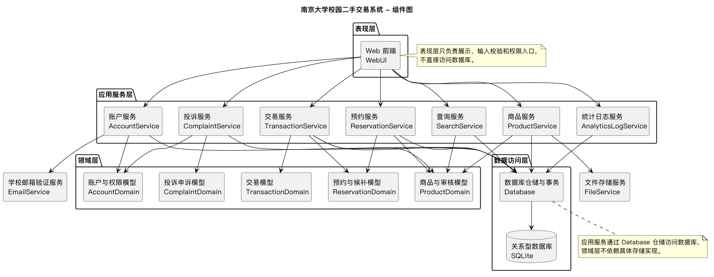
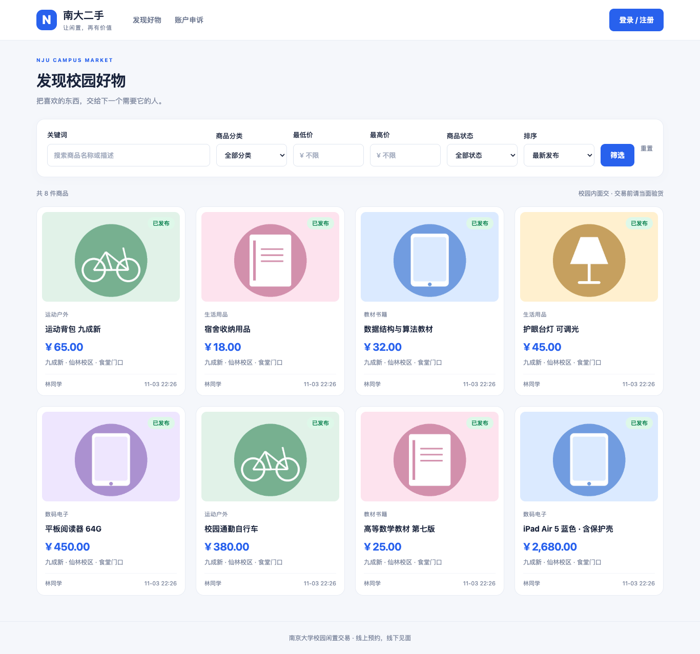

# 实验三：软件实现与构建

南京大学校园二手交易系统
学号：241220131　姓名：单锦曼
实验日期：2026年11月3日

## 一、实验目的与实现结果

本实验在实验二 UML 与需求说明的基础上，实现一个可在本机启动的校园二手交易程序，完成代码规范检查、运行验证与 Git 远程管理。系统支持线上预约、线下面交，不接入在线支付或物流。

实现采用 Python 3.13、Flask、Jinja 和 SQLite。普通用户同时具备买家和卖家身份；管理员负责审核及处置，初始管理员另有创建管理员权限。界面参考实验二设计，并适配桌面与移动浏览器。

| 项目 | 实际结果 |
| --- | --- |
| 功能范围 | 注册登录、商品版本审核、搜索筛选、预约候补、改价重审、双方成交、私有留言、投诉申诉、账户处置、分类统计与日志 |
| 源码规模 | 有效 Python 实现 1667 行，剔除演示数据模块 100 行后仍有 1567 行；测试、工具、模板和样式不计入此门槛 |
| 自动化验证 | 24 项 pytest 测试通过；Ruff 检查及格式检查通过；两种视口的真实浏览器交易流程通过 |
| 性能 | 500 条商品、20 并发、300 秒 HTTPS 测试；P95=2.577 秒，非预期失败为 0 |
| 远程管理 | 现有 GitHub 仓库的 lab3 分支，按计划、账户基础、交易业务、界面管理等阶段提交推送 |

报告中的数据来自 evidence/ 下的真实运行记录。开发邮件为本机模拟模式，真实 SMTP 发信和可信证书部署未进行验收。本人提交前仍需逐行阅读并确认所采用的代码，本报告不代替这一责任。

---

# 二、UML 如何转换为代码

| 设计元素 | 代码映射及理由 |
| --- | --- |
| User / Admin / InitialAdmin | domain.py 中保留角色继承；users 表统一持久化，服务层校验实际身份 |
| Product / ProductVersion / ReviewRecord | 映射商品、不可变版本与审核表；ProductService 统一送审、审核、可见性和版本冲突判断 |
| Reservation / Waitlist / Transaction | 映射独立表；ReservationService 与 TransactionService 组织事务，唯一约束保证活动锁定和成交唯一 |
| Complaint / Appeal / OperationLog | ComplaintService 处理投诉及处罚；补充 ModerationAction 和私有留言实体，AnalyticsLogService 提供统计查询 |

类图中的实体行为没有简单复制为每张表的同名 Python 类，而是分为领域值、关系表和应用服务。最新实现类图与实体关系图分别提交，明确哪些是实际 Python 类、哪些是持久化实体，避免图与代码的名称对应造成误解。

---

# 三、关键规则与实现取舍

## 1. 唯一锁定和竞争处理

每次写操作使用独立连接和 BEGIN IMMEDIATE 事务。reservations 在 LOCKED/SELLER_CONFIRMED 状态上建立商品部分唯一索引，页面携带 revision，服务端在事务中校验最新状态。候补不占锁，不能用进程内变量替代数据库约束。[3]

## 2. 预约确认与成交确认分离

卖家确认预约只记录 seller_accepted_at。买卖双方分别记录成交确认时间；第二个有效确认一次性写成交、完成预约、商品 SOLD 并终止其余候补。重复确认返回同一成交结果，成交后禁止取消和再次上架。

## 3. 改价重审不丢锁、不沿用旧确认

新版本送审后商品隐藏并暂停成交，活动预约保留，原成交确认清空。审核通过后有锁则恢复 RESERVED；新价格须由原买家明确接受，双方重新确认当前审核版本。驳回和取消不能把重审商品错误恢复为在售。

## 4. 处置与历史展示的边界

删除采用逻辑删除并保留成交关联。补充 publication_blocked，违规处置及其解除后仍不公开，重新审核通过才解除展示限制，避免历史 OFFLINE 可见性规则提前暴露违规内容。

## 5. 权限和凭据保护

口令使用独立随机盐的 scrypt。浏览器仅持有可撤销会话令牌，冻结、封禁和重置密码撤销原会话。表单与 JSON 写入均有 CSRF；图片解码校验并重编码，非公开图片也检查访问范围；SQL 参数化、模板默认转义。[1][2]

## 6. 从实验二到本次实现的变化

数据库由 MySQL 调整为 SQLite；采用文件模块分层，未引入空的多级目录。浏览器入口保留 REQ-051 的要求。增加未登录申诉核验、独立处罚实体和预约私有留言。仅初始管理员可创建管理员，沿用实验二较具体的权限约定。

---

# 四、构建与实际运行

验证环境：Apple M5，内存 16 GiB，macOS 26.6.2，arm64，Python 3.13.3。应用采用解释执行；以虚拟环境和固定依赖构建运行环境，常规 HTTP 使用 Waitress，本机 HTTPS 演示使用临时自签名证书。

启动顺序：安装 code/requirements.lock；依次执行 python -m marketplace init-db、init-admin、seed-demo、run --port 5001。首次管理员密码由交互或环境变量提供。初始化不会清空已有数据，普通启动不会自动写入示例数据。

商品列表支持关键词、分类、价格区间、状态组合筛选以及四种稳定排序。下架和成交历史可按权限展示，但只有当前可售且未锁定商品能预约。示例图片为程序绘制的示意图。

---

# 五、移动端与交易闭环展示

两个视口均实际完成：登录 → 查看详情 → 预约 → 取消 → 再次预约 → 卖家确认 → 私有留言 → 买家确认成交 → 卖家确认成交。单方确认时仍显示卖家已确认预约，另一方确认后才显示已成交。

浏览器检查同时断言核心页面无横向溢出，并保存管理工作台和日志截图。Browser 插件未发现可连接的浏览器，因此使用独立 Chromium 自动化执行；这不影响服务端权限和 CSRF 检查。

---

# 六、代码质量与验证结果

| 测试组 | 实际覆盖 |
| --- | --- |
| 账户与身份 | 注册及哈希、验证码尝试上限/过期/复用、域名校验、管理员限制、冻结、密码重置、会话撤销、受限申诉令牌 |
| 商品与权限 | 草稿可见性、送审字段及图片、编辑归属、重复提交、搜索边界、过期及冲突审核、页面渲染和 CSRF |
| 预约交易 | 卖家确认不等于成交、新价重确认、驳回期取消、候补顺序及转正、私有留言、重复成交和成交不可逆 |
| 管理与审计 | 投诉不自动处罚、核实封禁、申诉解除后重审、账户处置撤销原会话、删除后成交统计与日志保留 |
| 并发一致性 | 20 买家抢约重复三轮；最终成交与取消、候补转正与新预约、相反审核结果、改价与最终成交确认的竞争 |
| HTTP 与浏览器 | 正常及越权页面、无 CSRF 请求、非法整数、实际 HTML 表单、桌面与移动完整交易流程 |

实际检查输出：pytest 为 24 passed；Ruff 为 All checks passed；18 个 Python 文件符合格式要求。测试结果不是对所有输入和生产环境的穷尽证明，真实发信、可信证书和更大容量仍在验证边界外。

## 源码规模统计口径

scripts/source_stats.py 按 Python token 统计有效物理行，排除空白、注释及独立文档字符串。应用实现合计 1667 行，移除演示数据模块后为 1567 行；测试 538 行；SQL 文件 106 个物理行；另有 13 个模板。界面均手写，无 GUI 设计工具自动生成代码计入门槛。

行数及测试明细保存在 evidence/source-stats.json、tests.txt、lint.txt 和 browser/browser-results.json，可按 README 命令复查。

---

# 七、HTTPS 性能与容量验收

负载在独立临时数据库上进行，避免影响浏览器演示数据。测试先创建 500 条已审核商品及 20 个买家，每个并发用户保持独立 cookie 会话；预热登录不计时。目标操作为登录、列表、详情、预约，预定比例约为 10%/40%/30%/20%。

| 指标 | 真实结果 | 验收条件 |
| --- | --- | --- |
| 持续时间 | 300.891 秒 | 不少于 300 秒 |
| 并发用户 / 初始商品 | 20 / 500 | 20 / 至少 500 |
| 样本总数 | 5930 | 四类目标 HTTP 请求 |
| 平均 / P95 / 最大耗时 | 1.014 / 2.577 / 2.992 秒 | P95 ≤ 3 秒 |
| 非预期失败 | 0，失败率 0.00% | 失败率 ≤ 1% |
| 结果 | 本次本机负载达标 | 不能外推为上千用户容量 |

| HTTP 结果分类 | 请求数 |
| --- | --- |
| 登录成功 / 列表成功 / 详情成功 | 597 / 2378 / 1767 |
| 预约成功 / 正常预约冲突 409 | 456 / 732 |
| 超时、5xx 和其他非预期异常 | 0 |

测试通过 https://127.0.0.1:5003 进行。证书为临时自签名证书，客户端仅在此次本机测试中跳过证书信任验证；加密传输与可信证书身份认证是不同的验证内容。本次结果不代表公网网络、生产部署或浏览器端渲染延时。

预约使用初始商品版本快照，后续竞争导致的状态变化和 409 是预期拒绝，单独列出而非作为系统故障。原始汇总和测试环境分别见 evidence/load-results.json 与 environment.json。

---

# 八、大模型辅助与 Git 管理

本次使用 Codex 辅助需求核对、架构拆解、代码实现、测试编写、问题修正及报告整理。用户先要求只做计划，检查后再授权实现，并明确要求按阶段及时提交推送；最终确认沿用学号与姓名。报告只记录实际发生的交互，不虚构本人逐行审阅或模型使用经历。

| 辅助过程 | 发现的问题与修正方式 |
| --- | --- |
| 补充上下文 | 先读取完整需求及 UML，而不是仅凭实验标题生成程序；从需求发现浏览器约束，放弃先前 Tkinter 建议 |
| 拆解规则再编码 | 先明确状态、权限、事务及验收场景，再实现服务；区分卖家确认预约、新价接受和双方成交确认 |
| 测试反馈修正 | HTTP 测试发现模板宏缺少上下文；真实浏览器发现 HTML 表单被生成为 API 地址；修正路由顺序并补回归断言 |
| 反例驱动检查 | 补充违规解除后历史下架内容提前公开的反例，引入 publication_blocked；保留 HTTPS CSRF 检查并修正负载脚本同源请求头 |

上述过程体现了补充需求上下文、先写规则、使用异常与竞争场景检验输出的方法。模型结果仍需本人阅读和判断；项目提供可复现脚本及模块说明供逐行检查，未把自动化测试等同于人工审阅。

## Git 本地及远程管理展示

| 提交 | 阶段内容 |
| --- | --- |
| cd143b7 | 实现方案与验收计划 |
| 5ef984c | 持久化、账户服务与七项初始测试 |
| cd56048 | 商品版本审核、预约候补与一致性交易 |
| a5dbbe5 | 响应式界面、管理功能及相关回归测试 |

远程仓库：https://github.com/235826/secondhand-marketplace ，分支 lab3。上述阶段均执行 git push，并用 git ls-remote 核对代码提交与远程分支一致。未强制推送；数据库、验证码、真实凭据、虚拟环境和缓存均排除在提交范围之外。

---

# 九、复现、限制与提交内容

## 交付结构

实验3_241220131_单锦曼.zip 解压后，顶层为同名文件夹，包含实验报告.pdf、UML/ 和 code/。UML 提供六组 PlantUML 源文件与 PNG；code 提供应用、依赖锁定清单、README、测试和验证脚本。运行数据及私钥不包含在提交包中。

## 复现与验证边界

按 code/README.md 创建 Python 虚拟环境并安装固定依赖，显式初始化数据库与管理员，再生成虚构演示数据并启动。若重跑浏览器或负载脚本，应创建新的隔离 instance；演示脚本会生成成交记录，不覆盖个人业务数据。

邮件默认写入本机 outbox，只演示验证码流程，未验证真实邮件投递及邮箱归属。HTTPS 为本机自签名演示，未验证可信证书或公开部署。数据库目前只有 SQLite 实现，不声称已实现 MySQL、分布式锁或跨机器扩容。

公开商品与历史成交展示、隐私和状态冲突已纳入测试，但仍需本人依据课程要求逐行阅读代码、复查需求映射并对提交负责。实验二原始设计材料保持不变，实验三 UML 单独修订并说明差异。

## 参考资料

[1] Pallets. Flask Tutorial. https://flask.palletsprojects.com/en/stable/tutorial/ （访问：2026-11-03）。用于应用组织、模板与测试设计参考。

[2] Flask-WTF. CSRF Protection. https://flask-wtf.readthedocs.io/en/1.2.x/csrf/ （访问：2026-11-03）。用于表单及 JSON 请求的 CSRF 接入。

[3] SQLite. Partial Indexes. https://www.sqlite.org/partialindex.html （访问：2026-11-03）。用于活动预约的部分唯一索引设计。

[4] 本课程实验三：软件实现与构建，lab3/lab3.md。

[5] 本项目需求说明 requirements.md（第二版），实验二报告与 UML 设计材料。
